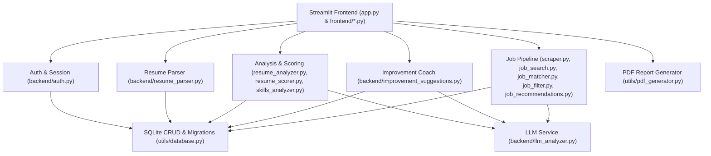

# System Architecture

## Overview
The AI-Powered Resume Analysis & Intelligent Job Recommendation System follows a modular three-tier Python architecture cleanly separated into Presentation (`frontend/`), Domain & AI Services (`backend/`), and Shared Infrastructure (`utils/` + `data/`).

---

## Layer Responsibilities

### 1. Frontend Layer (`frontend/` & `app.py`)
- **`app.py` / `frontend/app.py`**: Entry point, Streamlit page configuration, database initialization, and authentication guard routing between `login.py`, `registration.py`, and `dashboard.py`.
- **`frontend/dashboard.py`**: Unified sidebar navigation across 9 modules (`Overview`, `My Profile`, `Upload Resume`, `Resume Analysis`, `Skills Gap`, `Improve Resume`, `Job Preferences`, `Job Recommendations`, `Settings`) with persistent `st.session_state`.
- **Feature Views**: Dedicated modular views for upload (`upload_resume.py`), interactive score/card dashboard (`analysis.py`), gap charts (`skills_gap_page.py`), before/after editor (`improvement.py`), search configuration (`job_preferences.py`), and ranked recommendations + tracker (`job_recommendations.py`).

### 2. Backend Domain Layer (`backend/`)
- **Authentication (`auth.py`)**: Enforces backend input/password rules via `utils/validators.py`, hashes passwords via `bcrypt` (`utils/security.py`), manages Streamlit sessions, and records user activity logs.
- **Resume Parsing (`resume_parser.py`)**: Extracts text across all PDF pages (`pdfplumber` with `PyPDF2` fallback), extracts DOCX paragraphs and tables (`python-docx`), detects password-protected/corrupted/scanned files, cleans whitespace, and identifies sections.
- **LLM Gateway (`llm_analyzer.py`)**: Encapsulates Google Gemini, OpenAI, and Ollama behind LangChain `PromptTemplate`s, `tenacity` exponential backoff retries, strict JSON extraction, token/cost estimation, and safe fallback signaling when live API keys are unconfigured.
- **Analysis Engines (`resume_analyzer.py`, `resume_scorer.py`, `skills_analyzer.py`, `improvement_suggestions.py`)**:
  - Score calculation strictly enforces Milestone 2 weights (`0.25*Completeness + 0.30*Content + 0.15*Formatting + 0.20*Keywords + 0.10*Experience`).
  - Hash-based caching (`content_hash = sha256(resume_text + target_role)`) avoids redundant API calls.
  - Every component operates cleanly in both Live LLM Mode and deterministic Evidence-Based Demo Mode.
- **Job Intelligence Pipeline (`scraper.py`, `job_search.py`, `job_matcher.py`, `job_filter.py`, `job_recommendations.py`)**:
  - Uses a common `BaseJobSource` abstraction across Remotive, The Muse, Arbeitnow, optional compliant Selenium (`LinkedInSeleniumScraper`), and an offline fallback catalog.
  - Matching strictly applies Milestone 3 weights (`0.50*Skills + 0.25*Experience + 0.15*Education + 0.10*Responsibilities`).
  - Multi-factor ranking orders by match %, posted date, competition, and user preferences, while generating tailored application tips, comparison tables, and application tracking.

### 3. Utility & Data Layer (`utils/` & `data/`)
- **`utils/database.py`**: SQLite connection factory, additive non-destructive migrations (`PRAGMA table_info`), foreign-key enforcement, indexing, and typed CRUD functions.
- **`utils/pdf_generator.py`**: Renders Matplotlib charts and ReportLab Platypus tables/badges into downloadable PDFs saved under `data/reports/`.
- **`utils/logger.py`**: Rotating file logger (`data/app.log`) tracking auth events, extractions, API usage/errors, and scraping runs.
