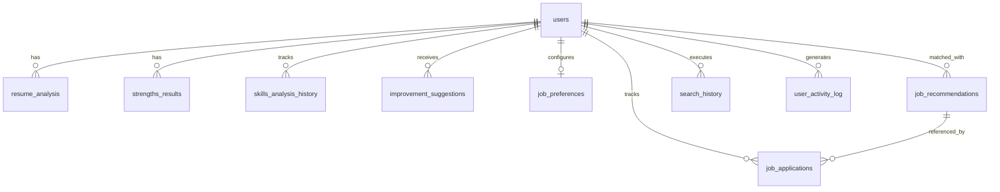

# Database Schema Reference

**Database Engine:** SQLite 3 (`data/app.db`)  
**Foreign Keys:** Enabled (`PRAGMA foreign_keys = ON`)  
**Migration Strategy:** Additive, non-destructive (`CREATE TABLE IF NOT EXISTS` and column checks via `PRAGMA table_info`).

---

## Entity-Relationship Overview

---

## Table Specifications

### 1. `users`
Stores registered user accounts, credentials, uploaded resume paths, and profile attributes.
- `id` (`INTEGER PK AUTOINCREMENT`)
- `name` (`TEXT NOT NULL`)
- `email` (`TEXT NOT NULL UNIQUE`, indexed `idx_users_email`)
- `password_hash` (`TEXT NOT NULL`, bcrypt hash)
- `registered_at` (`TEXT NOT NULL`)
- `resume_path` (`TEXT`)
- `phone`, `location`, `linkedin_url`, `target_role`, `experience_years`, `education_level`, `bio`, `updated_at`

### 2. `resume_analysis`
Stores extracted resume text, weighted component scores, strengths, weaknesses, skills, and cache hash.
- `id` (`INTEGER PK AUTOINCREMENT`)
- `user_id` (`INTEGER NOT NULL FK -> users.id`, indexed `idx_resume_user`)
- `resume_text` (`TEXT NOT NULL`)
- `analysis_scores`, `strengths`, `weaknesses`, `identified_skills`, `recommended_skills`, `analysis_json` (`TEXT`)
- `overall_score` (`REAL DEFAULT 0`)
- `classification`, `target_role`, `content_hash` (indexed `idx_resume_hash`)
- `analyzed_at` (`TEXT NOT NULL`)

### 3. `strengths_results`
Preserves historical strengths snapshots linked to `users.id`.
- `id`, `user_id` (`FK -> users.id`), `strengths`, `generated_at`

### 4. `skills_analysis_history`
Tracks categorized skills and coverage percentages over time.
- `id`, `user_id` (`FK -> users.id`, indexed `idx_skills_hist_user`), `target_role`, `extracted_skills_json`, `missing_critical_json`, `missing_nice_json`, `recommendations_json`, `coverage_pct`, `created_at`

### 5. `improvement_suggestions`
Stores personalized improvement plans and interactive `Applied` / `Not Relevant` status maps.
- `id`, `user_id` (`FK -> users.id`, indexed `idx_impr_user`), `analysis_id`, `suggestions_json`, `status_map_json`, `created_at`, `updated_at`

### 6. `job_recommendations`
Stores collected job listings, extracted requirements, match scores, breakdowns, and application tips.
- `id`, `user_id` (`FK -> users.id`, indexed `idx_jobs_user`, `idx_jobs_user_url`), `job_title`, `company_name`, `location`, `job_description`, `job_url`, `match_percentage`, `scraped_at`
- `posted_date`, `job_type`, `remote_status`, `experience_level`, `salary_range`, `applicants_count`
- `required_skills`, `nice_to_have_skills`, `qualifications`, `responsibilities`
- `match_breakdown_json`, `match_explanation`, `application_tips_json`, `source`, `is_active`

### 7. `job_preferences`
Stores each user's saved job customization settings (`user_id UNIQUE`).
- `id`, `user_id`, `desired_title`, `preferred_locations_json`, `remote_preference`, `experience_level`, `job_types_json`, `min_salary`, `industries_json`, `company_size`, `include_keywords_json`, `exclude_keywords_json`, `max_commute_mins`, `visa_sponsorship`, `preferred_companies`, `min_match_threshold`, `schedule_frequency`, `email_notifications`, `updated_at`

### 8. `job_applications`
Tracks saved jobs and full application status transitions (`UNIQUE(user_id, job_id)`).
- `id`, `user_id` (`FK -> users.id`), `job_id` (`FK -> job_recommendations.id`), `status` (`Saved`, `Applied`, `Interviewing`, `Rejected`), `notes`, `applied_date`, `updated_at`, `status_history_json`

### 9. `search_history`
Logs job search queries, filters, result counts, and new job counts (`idx_search_hist_user`).

### 10. `user_activity_log` & `user_feedback`
- `user_activity_log`: Chronological user actions shown on the Dashboard Overview (`idx_activity_user`).
- `user_feedback`: In-app user feedback & support submissions.
